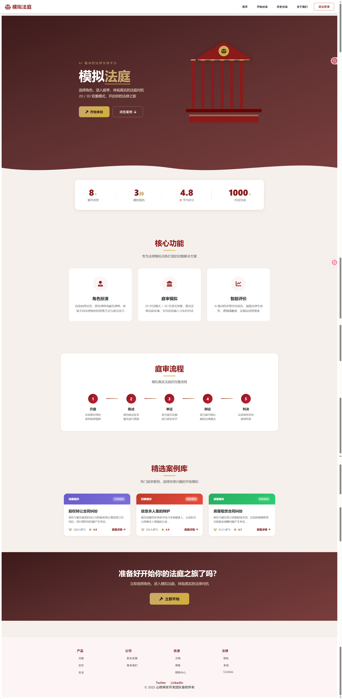
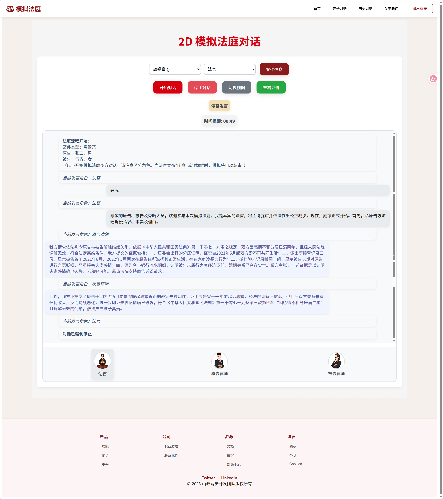
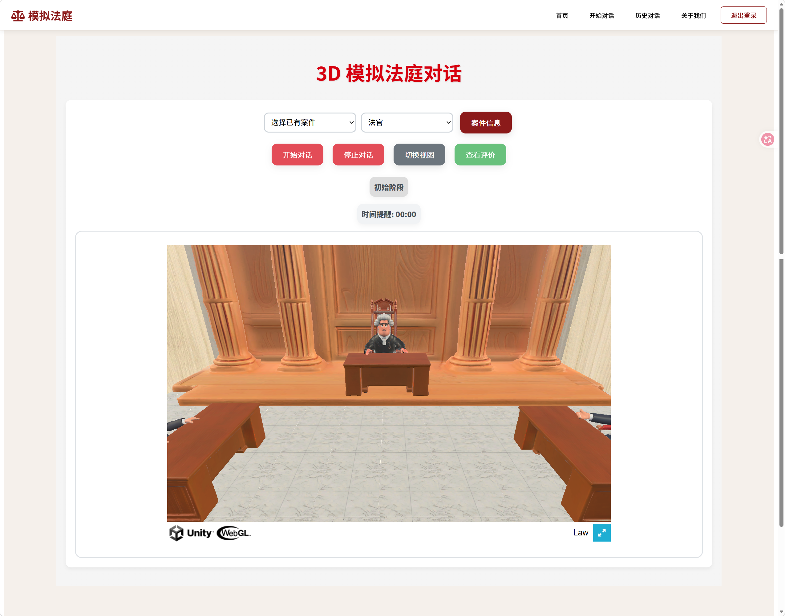
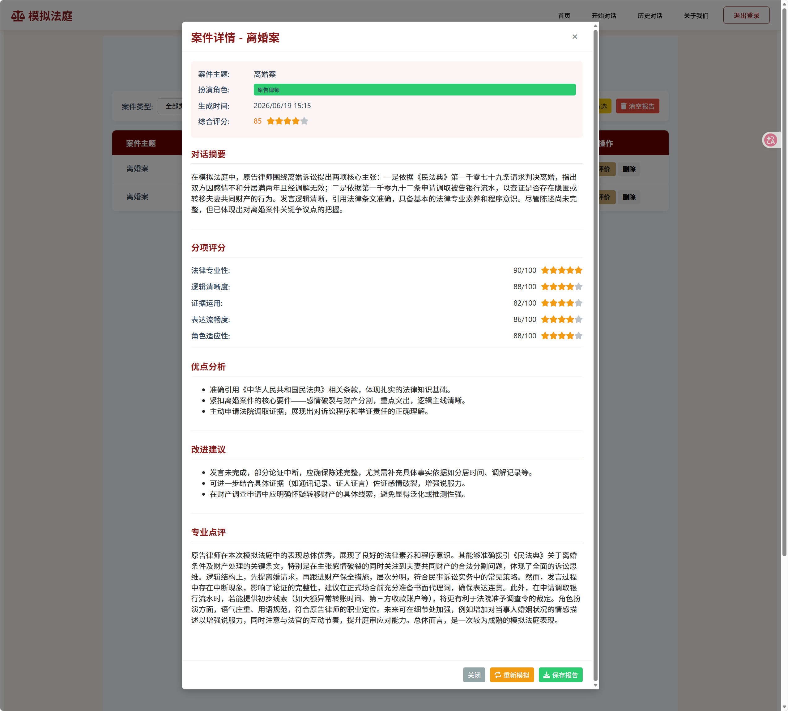
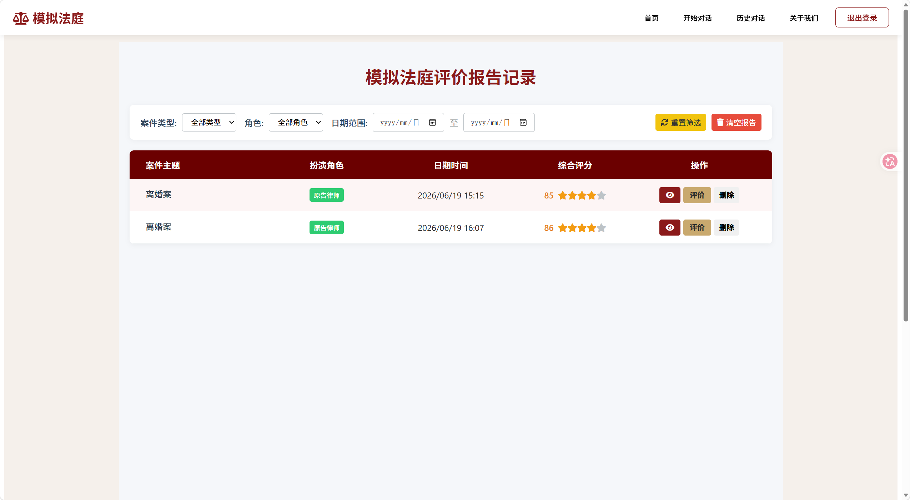

# 🏛️ 模拟法庭 | AI-Driven Legal Practice Platform

[中文](#中文介绍) | [English](#english)

[](https://vuejs.org/)
[](https://vitejs.dev/)
[](https://python.org/)
[](https://fastapi.tiangolo.com/)

## 中文介绍

**模拟法庭**是一个基于 AI 大模型的沉浸式法律实践平台。用户可以选择法官、原告律师、被告律师等角色，与 AI 驱动的其他角色开展多轮庭审对话。平台提供 **2D 对话模式**和 **3D 沉浸式场景**，并在庭审结束后生成 **AI 多维评估报告**，辅助法律实践训练。

> 山东政法学院网络空间安全学院

### 功能亮点

| 功能 | 说明 |
|---|---|
| 多角色扮演 | 选择法官、原告律师或被告律师，练习法律推理与庭审表达 |
| 2D / 3D 双模式 | 2D 对话专注内容，Unity WebGL 提供沉浸式法庭场景 |
| 语音输入 | 支持语音输入和语音转文字 |
| AI 智能对话 | 使用阿里云通义千问生成各方角色的法律发言 |
| 多维评估报告 | 从法律专业性、逻辑清晰度、证据运用和表达流畅度等维度评价 |
| 案件管理 | 自定义、保存和加载案件，持久化对话记录 |
| 用户认证 | 注册登录、JWT 身份认证与基于角色的访问控制（RBAC） |

### 界面预览

| 首页 | 2D 庭审对话 |
|---|---|
|  |  |

| 3D 法庭 | AI 评估报告 |
|---|---|
|  |  |



### 技术栈

- **前端**：Vue 3、Vite 6、Vue Router 4、Axios、Three.js、Unity WebGL。
- **后端**：Python、FastAPI、Uvicorn、MySQL。
- **AI 服务**：阿里云 DashScope，通义千问 `qwen-plus`。
- **认证**：JWT（HS256）与 RBAC。
- **样式**：CSS 自定义变量，统一红色法律主题。

### 后端服务

| 服务 | 文件 | 端口 | 职责 |
|---|---|---|---|
| 主对话服务 | `main.py` | 8000 | 流式 AI 对话、评估报告生成 |
| 认证服务 | `rbac_auth.py` | 8001 | 注册登录、JWT 签发与验证 |
| 任务服务 | `task_management.py` | 8002 | 任务 CRUD |
| 庭审评估服务 | `court_evaluation_backend.py` | 8003 | 报告存储和查询 |
| 案件服务 | `case_model.py` | 8004 | 案件与对话记录管理 |

### 快速开始

环境要求：Node.js 18+、Python 3.10+、MySQL 8.0+。

**1. 克隆仓库**

```bash
git clone https://github.com/zeng-sdzfxy/AI-Driven-Legal-Practice-Platform.git
cd AI-Driven-Legal-Practice-Platform
```

**2. 启动前端**

```bash
npm install
npm run dev
```

前端默认地址：`http://localhost:5173`。

**3. 配置并启动后端**

```bash
python -m venv .venv
# macOS / Linux
source .venv/bin/activate
# Windows
# .venv\Scripts\activate
pip install fastapi uvicorn pymysql python-dotenv pyjwt
# macOS / Linux
cp .env.example .env
# Windows PowerShell
# Copy-Item .env.example .env
```

编辑 `.env`，配置 API Key、数据库连接和 JWT 密钥。启动 MySQL，并创建数据库：

```sql
CREATE DATABASE rbac_system DEFAULT CHARACTER SET utf8mb4;
```

后端服务启动时会自动创建所需数据表。启动所有服务：

```bash
python start_services.py
```

默认使用端口 8000–8004。

### 环境变量

| 变量 | 用途 / 默认值 |
|---|---|
| `DASHSCOPE_API_KEY` | 阿里云 DashScope API Key |
| `DB_USER` / `DB_PASSWORD` | MySQL 用户名与密码 |
| `DB_HOST` | 数据库主机，通常为 `localhost` |
| `DB_NAME` | 数据库名 `rbac_system` |
| `JWT_SECRET_KEY` | JWT 签名密钥 |
| `JWT_ALGORITHM` | `HS256` |
| `JWT_EXPIRE_MINUTES` | 令牌有效期，30 分钟 |
| `MAIN_SERVICE_PORT` | 8000 |
| `RBAC_SERVICE_PORT` | 8001 |
| `TASK_SERVICE_PORT` | 8002 |
| `COURT_SERVICE_PORT` | 8003 |
| `CASE_SERVICE_PORT` | 8004 |
| `CORS_ORIGINS` | `http://localhost:5173,http://127.0.0.1:5173` |

`.env` 已由 `.gitignore` 排除；仓库提供 `.env.example` 配置模板。

### 项目结构

| 路径 | 用途 |
|---|---|
| `index.html`、`package.json`、`vite.config.js` | 前端入口、依赖与构建配置 |
| `src/main.js`、`src/App.vue` | Vue 入口和根组件 |
| `src/router/` | 页面路由 |
| `src/views/` | 首页、庭审、登录、历史记录、关于我们和法庭场景 |
| `src/components/CourtRoom3D.vue` | Three.js 法庭组件 |
| `src/assets/` | 图片、视频与字体 |
| `src/style.css`、`src/theme.css` | 基础样式与主题变量 |
| `src/constants.js` | API 地址和存储键常量 |
| `public/` | Unity WebGL 宿主页及静态资源 |
| `public/Build/`、`public/TemplateData/` | Unity 构建产物与模板资源 |
| `config.py` | 共享环境配置 |
| `start_services.py` | 服务启动脚本 |
| `screenshots/` | 界面截图 |
| `dist/` | 前端构建输出 |

### 设计系统

主题变量集中在 `src/theme.css`。

| Token | 色值 | 用途 |
|---|---|---|
| `--color-primary` | `#8B1A1A` | 深红主色 |
| `--color-accent` | `#D7000F` | 强调红 |
| `--color-gold` | `#C9A96E` | 金色点缀 |
| `--color-bg-warm` | `#F5F0EB` | 暖白背景 |
| `--gradient-hero-light` | 浅红渐变 | Hero 背景 |

---

## English

**Mock Court** is an immersive legal practice platform powered by large language models. Users can act as a judge, a plaintiff's lawyer or a defendant's lawyer and participate in multi-turn hearings with AI-controlled participants. The platform provides a **2D conversation mode**, a **3D immersive courtroom** and **AI-generated multidimensional evaluation reports** to support legal practice training.

> School of Cyberspace Security, Shandong University of Political Science and Law

### Features

| Feature | Description |
|---|---|
| Role-based simulation | Practice legal reasoning and courtroom communication as a judge or lawyer. |
| 2D / 3D modes | Use a focused conversation interface or an immersive Unity WebGL courtroom. |
| Voice input | Speech input and speech-to-text support. |
| AI conversations | Generate role-specific legal statements with Alibaba Cloud Qwen. |
| Evaluation reports | Assess legal proficiency, logical clarity, evidence use and fluency. |
| Case management | Customize, save and load cases; persist conversation records. |
| Authentication | Registration, login, JWT and role-based access control. |

### Screenshots

| Home | 2D Hearing |
|---|---|
|  |  |

| 3D Courtroom | Evaluation Report |
|---|---|
|  |  |


### Technology Stack

- **Frontend:** Vue 3, Vite 6, Vue Router 4, Axios, Three.js and Unity WebGL.
- **Backend:** Python, FastAPI, Uvicorn and MySQL.
- **AI:** Alibaba Cloud DashScope, using Qwen (`qwen-plus`).
- **Authentication:** JWT (HS256) and role-based access control.
- **Styling:** CSS custom properties with a shared red legal theme.

### Backend Services

| Service | File | Port | Responsibility |
|---|---|---|---|
| Conversation | `main.py` | 8000 | Streaming AI replies and evaluation generation |
| Authentication | `rbac_auth.py` | 8001 | Registration, login and JWT validation |
| Tasks | `task_management.py` | 8002 | Task CRUD |
| Evaluation | `court_evaluation_backend.py` | 8003 | Report storage and retrieval |
| Cases | `case_model.py` | 8004 | Case and conversation management |

### Quick Start

Requirements: Node.js 18+, Python 3.10+ and MySQL 8.0+.

**1. Clone the repository**

```bash
git clone https://github.com/zeng-sdzfxy/AI-Driven-Legal-Practice-Platform.git
cd AI-Driven-Legal-Practice-Platform
```

**2. Start the frontend**

```bash
npm install
npm run dev
```

The frontend normally runs at `http://localhost:5173`.

**3. Configure and start the backend**

```bash
python -m venv .venv
# macOS / Linux
source .venv/bin/activate
# Windows
# .venv\Scripts\activate
pip install fastapi uvicorn pymysql python-dotenv pyjwt
# macOS / Linux
cp .env.example .env
# Windows PowerShell
# Copy-Item .env.example .env
```

Edit `.env` to supply your API key, MySQL settings and JWT secret. Start MySQL and create the database:

```sql
CREATE DATABASE rbac_system DEFAULT CHARACTER SET utf8mb4;
```

Backend services create the required tables on startup. Launch all services:

```bash
python start_services.py
```

Services use ports 8000–8004 by default.

### Environment Variables

| Variable | Purpose / Default |
|---|---|
| `DASHSCOPE_API_KEY` | Alibaba Cloud DashScope API key |
| `DB_USER` / `DB_PASSWORD` | MySQL credentials |
| `DB_HOST` | Database host, normally `localhost` |
| `DB_NAME` | Database name, `rbac_system` |
| `JWT_SECRET_KEY` | JWT signing secret |
| `JWT_ALGORITHM` | `HS256` |
| `JWT_EXPIRE_MINUTES` | Token lifetime, 30 minutes |
| `MAIN_SERVICE_PORT` | 8000 |
| `RBAC_SERVICE_PORT` | 8001 |
| `TASK_SERVICE_PORT` | 8002 |
| `COURT_SERVICE_PORT` | 8003 |
| `CASE_SERVICE_PORT` | 8004 |
| `CORS_ORIGINS` | `http://localhost:5173,http://127.0.0.1:5173` |

The `.env` file is excluded by `.gitignore`; `.env.example` provides the configuration template.

### Project Structure

| Path | Purpose |
|---|---|
| `index.html`, `package.json`, `vite.config.js` | Frontend entry, dependencies and build configuration |
| `src/main.js`, `src/App.vue` | Vue entry and root component |
| `src/router/` | Page routing |
| `src/views/` | Home, hearing, login, history, about and courtroom pages |
| `src/components/CourtRoom3D.vue` | Three.js courtroom component |
| `src/assets/` | Images, videos and fonts |
| `src/style.css`, `src/theme.css` | Base styles and theme variables |
| `src/constants.js` | API addresses and storage keys |
| `public/` | Unity WebGL host page and static resources |
| `public/Build/`, `public/TemplateData/` | Unity build and template assets |
| `config.py` | Shared environment configuration |
| `start_services.py` | Service launcher |
| `screenshots/` | Interface screenshots |
| `dist/` | Frontend build output |

### Design System

Shared theme variables are defined in `src/theme.css`.

| Token | Value | Purpose |
|---|---|---|
| `--color-primary` | `#8B1A1A` | Dark red primary color |
| `--color-accent` | `#D7000F` | Red accent |
| `--color-gold` | `#C9A96E` | Gold accent |
| `--color-bg-warm` | `#F5F0EB` | Warm page background |
| `--gradient-hero-light` | Light red gradient | Hero background |
